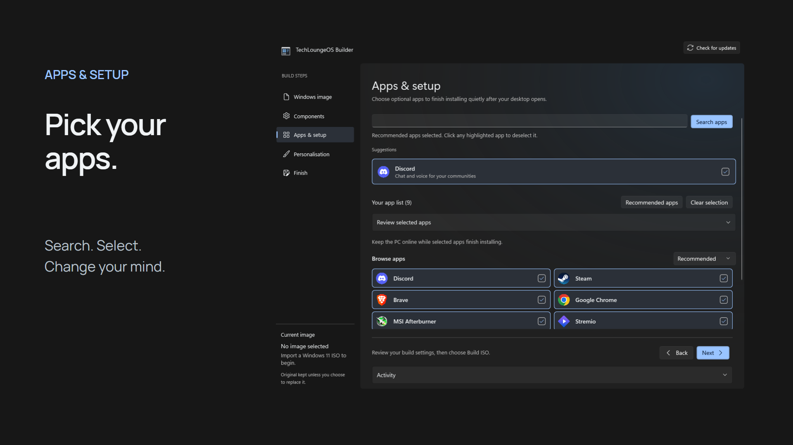

# TechLoungeOS Builder

Build a Windows 11 installer with your apps, desktop and setup preferences already chosen.

- Import an ISO, choose its edition and customise optional components.
- Search for apps or select the recommended set, including Discord, Stremio, Proton VPN and HWiNFO64.
- Create a local account and device name in the redesigned WinPE setup.
- Include Microsoft 365, runtimes, Store/Xbox and TechLoungeTweaks integration.
- Reach the desktop first, then finish installs quietly with progress and retry controls.
- Run the Boot Optimizer after selected apps finish installing.
- Choose OLED-friendly wallpapers, colours and desktop defaults.
- Export a bootable ISO or create a verified setup USB.
- Apply supported Windows updates with checks for retained components and settings.
- Check for signed Builder updates automatically, with installation after the app closes.

Your original ISO is retained unless you explicitly choose and confirm replacement. This is a separate app from TechLoungeTweaks. Windows, Office and third-party apps retain their own licensing requirements.

Requires Windows 11 x64, administrator permission, local NTFS working space and the Microsoft ADK Deployment Tools for ISO export. Selected online apps need internet at first sign-in.

Office uses the normal Microsoft deployment tools and your own account or licence. Activation tools are not included.

**Unreleased:** Ghost and standard-image servicing/install checks have passed for their recorded media, including selected apps, Office, TechLoungeTweaks and ordinary recovery. Candidate 0.1.35 and the refreshed Ghost ISO passed package and full media checks. The current 16 GB virtual USB passed writing, file verification, BIOS boot and UEFI Secure Boot with TPM 2.0. Public hosting and live hosted-update verification await publishing approval. Physical hardware and unreviewed Windows upgrade routes are not certified. See [test results](TechLoungeOS/TEST-RESULTS.md) and [compatibility](TechLoungeOS/COMPATIBILITY.md). The video uses edited app and VM captures.

[Build and technical documentation](TechLoungeOS/README.md)
